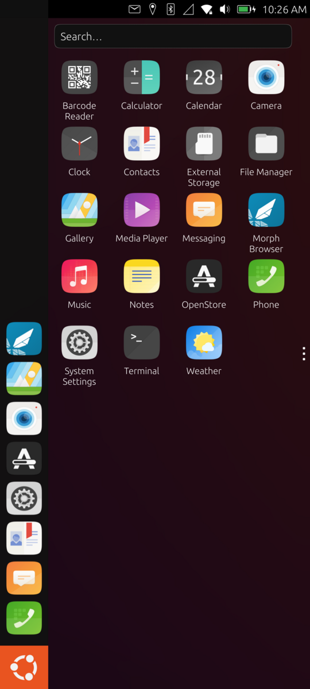
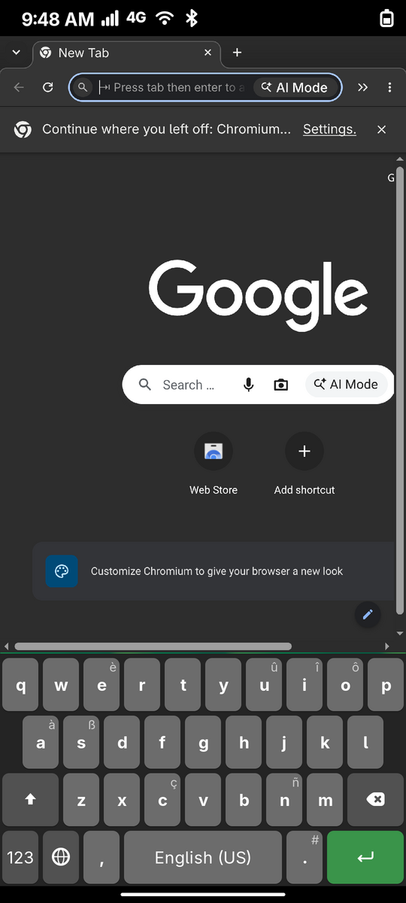
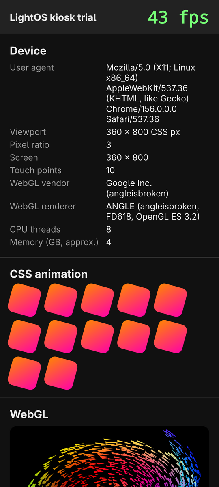
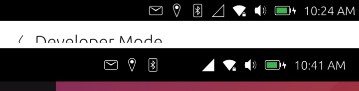

# android2linux

**Free your phone from Google and Apple. Pair with an AI to do it.**

A phone running real Linux is yours: no account required, no tracking you didn't choose, software you can read and change. Projects like [postmarketOS](https://postmarketos.org) and [Ubuntu Touch](https://ubports.com) have made this possible for years. What stopped most people was everything around it: knowledge scattered across wikis, forums and kernel source, guides written for a slightly different phone, and the fear of bricking the device on step 4.

That's the part an AI assistant changes. It reads the wiki, the package recipes and the source code for your exact phone. It checks what a random GitHub repo actually contains before you flash it. It runs the read-only checks first, explains every command before it runs, keeps each change reversible, and stays with you through the debugging that no guide covers. You still make every decision. You just don't have to be a kernel developer anymore.

This repo is what we learned doing exactly that, packaged so you and your assistant can do it too:

- **An agent skill** ([`skills/android2linux`](skills/android2linux/SKILL.md)) that turns a coding assistant into a careful pairing partner for this work: the method, the safety rules, and when to read what.
- **References** for humans and assistants alike: device dossiers, step-by-step guides, and a list of gotchas that each cost real time once.
- **Scripts** for the common steps: phone facts, ROM verification, patching, modem diagnostics, screenshots, a Chromium kiosk.
- **Apps** ([`apps/`](apps/)): web apps reworked for phone screens, installed with one command; WhatsApp is the first.
- **[An awesome list](AWESOME.md)** of the operating systems, tools, apps and communities that make all this possible.

## What happened, in short

Two phones, one weekend in November 2026, a Linux PC, and an AI assistant.

**Poco X8 Pro Max** (`dash`, MediaTek Dimensity 9500s). A promising GitHub repo turned out to be for the *Poco X8 Pro* (`klee`), a different phone with a different chip. No Linux port exists for this one yet, and the chip has no rescue mode if a flash goes wrong. The honest answer was "not today", plus what works instead. → [dossier](skills/android2linux/references/devices/xiaomi-poco-x8-pro-max.md)

**Redmi Note 9 Pro Max** (`excalibur`, Snapdragon 720G), a spare phone:

1. Bootloader unlocked from Linux (no Windows tool needed), downgraded safely to Android 10 after checking the anti-rollback index, Ubuntu Touch 24.04 installed. Switching to the 24.04-2.x series fixed the status bar running under the camera hole.
2. Then **postmarketOS**, on a variant it officially doesn't support. Its bootloader didn't recognise the phone, so we patched 14 bytes in U-Boot's device-tree match, and it booted: display, touch, GPU, Wi-Fi.
3. The SIM didn't work. Same SIM, firmware and hardware worked on Ubuntu Touch, so the problem had to be on the Linux side. The trail led to a small file server the modem uses at startup; the version shipped had a bug the upstream project had already fixed. Built the fix, and the phone got 4G at 28 Mbit/s, SMS, calls.
4. A **Chromium kiosk** booting straight into a web UI at 60 fps on the GPU, as the base for a custom phone OS.
5. **WhatsApp, reworked for the phone.** WhatsApp Web is a cramped desktop layout on a phone. A small Chromium extension, built by measuring the page's structure (never its content) and changing CSS live while the phone's owner watched, turned it into a one-pane app with a back button and a bottom bar. → [apps/whatsapp](apps/whatsapp/)

| Ubuntu Touch 24.04 | | postmarketOS v26.06 | |
|:---:|:---:|:---:|:---:|
|  |  |  |  |
| Home, after the status-bar fix | App drawer | Chromium in Phosh, on 4G | The kiosk test page, GPU-rendered |



*Top: Ubuntu Touch 24.04-1.x draws the status bar into the rounded corner. Bottom: 24.04-2.x reads the phone's cutouts, so the clock sits clear of the corner and the icons part around the camera hole.*

Not everything works: there's no charger driver for this chip in mainline Linux (it charges slowly on its default settings), and the cameras need drivers that don't exist yet. The dossier says exactly what works, what doesn't, and why. → [dossier](skills/android2linux/references/devices/xiaomi-redmi-note-9-pro-max.md)

## Use it

**With an AI assistant** (the intended way). Install the skill so your assistant loads it when you talk about Linux on phones. For Claude Code:

```sh
git clone https://github.com/alantriesagain/android2linux
mkdir -p ~/.claude/skills
cp -r android2linux/skills/android2linux ~/.claude/skills/
```

Then start a session in a working folder and say what you want, for example *"I have a Redmi Note 9 Pro, can it run Linux?"* or *"my SIM doesn't work on postmarketOS"*. Other assistants that support agent skills can load the same folder; any assistant can read the references directly.

**Without one**, start with [assess-your-phone.md](skills/android2linux/references/guides/assess-your-phone.md) and follow the links.

## The guides

| | |
|---|---|
| [Assess your phone](skills/android2linux/references/guides/assess-your-phone.md) | Can it run Linux? Codename first, then ports, then the unlock policy |
| [Unlock a Xiaomi from Linux](skills/android2linux/references/guides/xiaomi-unlock-from-linux.md) | Mi Unlock binding, MiUnlockTool with browser login |
| [Safe flashing](skills/android2linux/references/guides/safe-flashing.md) | Read-only checks, verifying ROMs, anti-rollback, never relock |
| [Ubuntu Touch](skills/android2linux/references/guides/ubuntu-touch.md) | Installer, access, the read-only system, notch fix |
| [postmarketOS on an unsupported variant](skills/android2linux/references/guides/postmarketos-unsupported-variant.md) | pmbootstrap from git, the U-Boot match patch, flashing |
| [Qualcomm modem debugging](skills/android2linux/references/guides/qualcomm-modem-debugging.md) | From `DeviceNotReady` to 4G: the method and the fix |
| [Charging without a driver](skills/android2linux/references/guides/charging-without-a-driver.md) | What the hardware defaults give, and how to measure |
| [Chromium kiosk](skills/android2linux/references/guides/chromium-kiosk.md) | cage + Chromium full-screen, scale, DevTools from the PC |
| [Working from your PC](skills/android2linux/references/guides/working-from-your-pc.md) | SSH, adb, screenshots, sudo, pitfalls |
| [Communities and AI](skills/android2linux/references/guides/communities-and-ai.md) | Each project's rules, and how to report bugs well |
| [Gotchas](skills/android2linux/references/gotchas.md) | Every pitfall, one line each |

## Rework apps for the phone

Many services have no Linux app, only a web app designed for a desktop screen. You don't have to accept that layout: a small browser extension can reshape it for a phone, and an AI pair makes that a short session rather than a project. [`apps/`](apps/) is a growing catalogue of them, with one installer for all; the first is [WhatsApp](apps/whatsapp/). The [tools](apps/dev/) used to build it are there too: a structure probe that maps a page without reading its content, and live CSS injection so the person holding the phone sees each change at once.

## Safety

Flashing a phone can destroy it and its data. The skill and the guides follow a few rules that are never broken: never relock a bootloader on modified software, never flash an image for another codename, never go below the phone's anti-rollback index, back up before anything that wipes. Your assistant should explain each step before running it; if it doesn't, ask. You are responsible for your device.

## Working with the projects

The Linux phone projects are built by volunteers, and each sets its own rules. postmarketOS forbids contributions made with generative AI, so anything you post there (bug reports, merge requests, chat) should be written by you, from what you understood. The skill knows this and won't write those for you. Use AI as much as you like on your own phone; respect each community's rules when you talk to them. → [Communities and AI](skills/android2linux/references/guides/communities-and-ai.md)

## Add your phone

Got a phone working (or learned that it can't)? Add a dossier under [`references/devices/`](skills/android2linux/references/devices/), following the existing ones: facts, what you tried, what works, what doesn't, how to go back, and the date you checked. Leave out serial numbers, IMEIs and other private data.

## License

MIT, see [LICENSE](LICENSE). The projects this builds on (postmarketOS, Ubuntu Touch, U-Boot, the Linux kernel, tqftpserv and others) have their own licenses. This repo contains no firmware: vendor firmware is proprietary and stays on your own machine.
