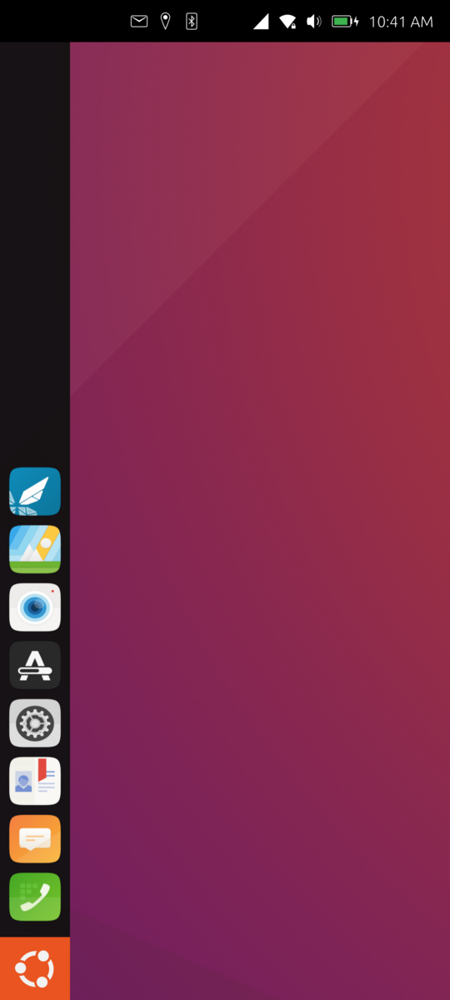

# android2linux

Replace Android on your phone with Linux, working through it with an AI assistant.

Linux phone systems such as [postmarketOS](https://postmarketos.org) and [Ubuntu Touch](https://ubports.com) run on many phones, but getting one onto a specific phone means finding the right port, unlocking the bootloader, flashing safely and fixing whatever hardware doesn't work yet. The information is spread across wikis, forums and source code, and mistakes can brick the phone. An AI assistant can do that research for your exact phone, check each step before it runs, and explain what it does. This repository gives the assistant the method, the safety rules and what has already been learned, and gives you the same material to read.

## Contents

- [What's in this repository](#whats-in-this-repository)
- [Phones](#phones)
- [Getting started](#getting-started)
- [Safety](#safety)
- [Guides](#guides)
- [Apps](#apps)
- [Contributing](#contributing)
- [License](#license)

## What's in this repository

| | |
|---|---|
| [`skills/android2linux/`](skills/android2linux/SKILL.md) | An agent skill: the method, the safety rules, and which guide to read when |
| [Guides](skills/android2linux/references/guides/) | The method step by step, for any phone, and a list of [gotchas](skills/android2linux/references/gotchas.md) |
| [`phones/`](phones/) | One folder per phone: what runs on it, how to install it, what works, the fixes it needs |
| [`apps/`](apps/) | Web apps reworked for phone screens, with one installer |
| [`scripts/`](skills/android2linux/scripts/README.md) | Tools for the common steps: phone facts, ROM checks, patching, modem diagnostics, screenshots, a kiosk |
| [`AWESOME.md`](AWESOME.md) | The systems, tools, apps and communities this builds on |

## Phones

| Phone | Chip | Linux | Status |
|---|---|---|---|
| [Xiaomi Redmi Note 9 Pro Max](phones/xiaomi-excalibur/) (`excalibur`) | Snapdragon 720G | Ubuntu Touch 24.04; postmarketOS v26.06 | Both run. postmarketOS needs two fixes for this variant; no charger driver and no cameras yet |
| [Xiaomi Poco X8 Pro Max](phones/xiaomi-dash/) (`dash`) | Dimensity 9500s | none yet | No Linux port; Linux runs only inside Android |

The full list, generated from each phone's `phone.json`, is in [`phones/`](phones/).

| Ubuntu Touch 24.04 | | postmarketOS v26.06 |
|:---:|:---:|:---:|
|  |  |  |
| Home screen | App drawer | Chromium in Phosh, on 4G |

## Getting started

**With an AI assistant.** Install the skill so the assistant uses it when you talk about Linux on phones. Link it from a clone rather than copying it: the skill reads the `phones/` and `apps/` folders next to it, and `git pull` keeps everything current. For Claude Code:

```sh
git clone https://github.com/android2linux/android2linux ~/android2linux
mkdir -p ~/.claude/skills
ln -s ~/android2linux/skills/android2linux ~/.claude/skills/android2linux
```

Then start a session in a working folder and describe what you want, for example "I have a Redmi Note 9 Pro, can it run Linux?" or "my SIM doesn't work on postmarketOS". Other assistants that support agent skills can load the same folder.

**Without one.** Start with [Assess your phone](skills/android2linux/references/guides/assess-your-phone.md) and follow the links.

## Safety

Flashing a phone can destroy it and its data. The skill and the guides keep to a few rules: never relock a bootloader on modified software, never flash an image for another codename, never go below the phone's anti-rollback index, and back up before anything that wipes. The assistant explains each step before running it; if it doesn't, ask. You are responsible for your device.

## Guides

| Guide | Covers |
|---|---|
| [Assess your phone](skills/android2linux/references/guides/assess-your-phone.md) | Whether it can run Linux: codename, ports, unlock policy |
| [Unlock a Xiaomi from Linux](skills/android2linux/references/guides/xiaomi-unlock-from-linux.md) | Mi Unlock binding, MiUnlockTool with browser login |
| [Safe flashing](skills/android2linux/references/guides/safe-flashing.md) | Read-only checks, verifying ROMs, anti-rollback, never relock |
| [Ubuntu Touch](skills/android2linux/references/guides/ubuntu-touch.md) | Installer, access, the read-only system, notch fix |
| [postmarketOS on an unsupported variant](skills/android2linux/references/guides/postmarketos-unsupported-variant.md) | pmbootstrap from git, the U-Boot match patch, flashing |
| [Qualcomm modem debugging](skills/android2linux/references/guides/qualcomm-modem-debugging.md) | From `DeviceNotReady` to a working modem |
| [Charging without a driver](skills/android2linux/references/guides/charging-without-a-driver.md) | What the hardware defaults give, and how to measure |
| [Chromium kiosk, and Chromium in Phosh](skills/android2linux/references/guides/chromium-kiosk.md) | Full-screen web UIs with cage; web apps that fit the screen |
| [Working from your PC](skills/android2linux/references/guides/working-from-your-pc.md) | SSH, adb, screenshots, sudo, pitfalls |
| [Communities and AI](skills/android2linux/references/guides/communities-and-ai.md) | Each project's rules, and how to report bugs |
| [Gotchas](skills/android2linux/references/gotchas.md) | Pitfalls, one line each |

## Apps

Many services have no Linux app, only a web app made for a desktop screen. Each folder in [`apps/`](apps/) turns one into a phone app: the site in a Chromium window that fits the screen, an extension that adapts the layout where needed, and an icon in the app grid. [WhatsApp](apps/whatsapp/) is the first; [`apps/dev/`](apps/dev/) has the tools to build more.

## Contributing

- **A phone** you got working, or found can't work yet: add a folder under [`phones/`](phones/README.md), named by codename.
- **An app**: add a folder under [`apps/`](apps/README.md) with an `app.json`.
- **When you talk to the projects** this builds on, follow their rules on AI: postmarketOS forbids AI-made contributions, so anything you post there is yours to write. See [Communities and AI](skills/android2linux/references/guides/communities-and-ai.md).

Leave out serial numbers, IMEIs, phone numbers and other private data.

## License

MIT, see [LICENSE](LICENSE). The projects this builds on (postmarketOS, Ubuntu Touch, U-Boot, the Linux kernel, tqftpserv and others) have their own licenses. This repository contains no firmware: vendor firmware is proprietary and stays on your own machine.
