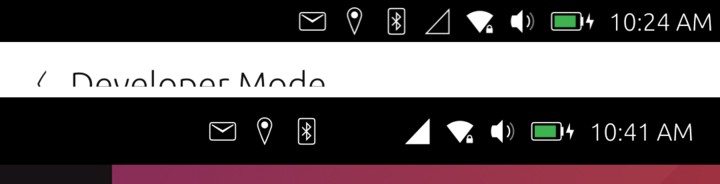

# Xiaomi Redmi Note 9 Pro Max (`excalibur`)

This is the device dossier for one phone that was actually moved off Android onto mainline Linux: a Redmi Note 9 Pro Max, codename `excalibur`, in the `miatoll` family. It records the facts you need to identify the phone, the exact path taken from stock MIUI through Ubuntu Touch to postmarketOS, what works on each system, the specific fixes that made the last step boot, how to get back, and when each claim was last checked. Use it as a worked example next to the general guides in [`../guides/assess-your-phone.md`](../../skills/android2linux/references/guides/assess-your-phone.md) and [`../guides/postmarketos-unsupported-variant.md`](../../skills/android2linux/references/guides/postmarketos-unsupported-variant.md).

## Device facts

| | |
|---|---|
| Phone | Redmi Note 9 Pro Max, India model `M2003J6B1I` |
| Codename | `excalibur` |
| Family | `miatoll` — also `curtana` (Note 9S), `joyeuse` (Note 9 Pro global), `gram` (Poco M2 Pro) |
| SoC | Qualcomm Snapdragon 720G (`SM7125`), Adreno 618 GPU |
| Panel | Huaxing FT8756 (`dsi_ft8756_huaxing_vid_display`) with FocalTech touch; 1080×2400, rounded corners, camera hole at the top centre |
| Partitions | A-only, dynamic partitions; `boot` 128 MiB, `cache` 384 MiB, `dtbo` 24 MiB, `super` 8 GiB, `userdata` ~105 GiB |
| Bootloader | unlocked 2026-11-20 with MiUnlockTool; **never relock it** with non-stock software — that bricks the phone. The phone's own bootloader (ABL, with fastboot) is untouched |
| Anti-rollback | index 1; not enforced on this family as far as anyone knows |
| Slots | single system slot (A-only), so dual boot with Android is not realistic — Linux replaces Android |

A-only matters before you start: there is no second slot to fall back on, and every flash writes the one copy in use. See [`../guides/safe-flashing.md`](../../skills/android2linux/references/guides/safe-flashing.md).

## The path taken

Each arrow is a separate install, with a wipe between them:

1. **Stock MIUI 14, Android 12** (`V14.0.2.0.SJXINXM`) — the state the phone arrived in.
2. **Bootloader unlock** (2026-11-20) — done from Linux with MiUnlockTool, no waiting period for this account, and the phone wiped immediately. See [`../guides/xiaomi-unlock-from-linux.md`](../../skills/android2linux/references/guides/xiaomi-unlock-from-linux.md).
3. **Android 10 downgrade** — the official MIUI 12 fastboot ROM `excalibur_in_global_images_V12.0.4.0.QJXINXM` (Android 10), about 3.1 GB. Ubuntu Touch on this phone runs over Android 10's hardware drivers, and the installer does not downgrade for you.
4. **Ubuntu Touch 24.04** — installed with the UBports Installer 0.11.2, channel 24.04 stable, Wipe Userdata + Partitioning + Bootstrap on. Display, touch, GPU, Wi-Fi and a mobile data connection were seen working; UBports' device page also lists calls and the camera as working (not tested here). See [`../guides/ubuntu-touch.md`](../../skills/android2linux/references/guides/ubuntu-touch.md).
5. **Ubuntu Touch 24.04-2.x** — switched channel to get cutout support for the rounded corners and camera hole; the 24.04-1.x series ran the status bar under them.

   

   *Top: 24.04-1.x draws the status bar into the rounded corner. Bottom: 24.04-2.x reads the phone's cutouts.*
6. **postmarketOS v26.06** (2026-11-20) — a near-mainline kernel with open GPU drivers, on an **unsupported variant** of a supported family. Excalibur has no device tree of its own; the Note 9 Pro (`joyeuse`) tree is the closest. Making it boot took a 14-byte patch to U-Boot (not upstream) and a locally built device package. See [`../guides/postmarketos-unsupported-variant.md`](../../skills/android2linux/references/guides/postmarketos-unsupported-variant.md).

Ubuntu Touch draws through Android's GPU drivers, so only its built-in browser (Qt WebEngine) gets acceleration. postmarketOS uses freedreno on mainline, so any current Chromium on any Wayland compositor gets the GPU — that was the reason for the move.

## Hardware status per OS

Status as tested. "Works" means it was exercised; "untested" means it was not tried, not that it fails.

| | Ubuntu Touch 24.04-2.x | postmarketOS v26.06 |
|---|---|---|
| Display, backlight | works | works |
| Touch | works | works (FocalTech FT8756) |
| GPU | works (Android drivers via Halium) | driver and firmware load (`a630_sqe.fw`, `a630_gmu.bin`), `/dev/dri/renderD128`; acceleration confirmed by GPU interrupts, Phosh renders on the Adreno |
| Wi-Fi | works | works (NetworkManager manages it) |
| Calls | listed as working by UBports (not tested here) | connect (dial → ringing → active); **call audio unverified**, `q6voiced` probably needed and not installed |
| Mobile data | works (had a Claro data connection) | works since 2026-11-21; registered on Claro, LTE, signal ~71 %, packet attached, ~28.6 Mbit/s down over IPv4 + IPv6 on `qmapmux0.0` |
| SMS | not recorded | works both ways (2026-11-21) |
| Camera | listed as working by UBports (not tested here) | **none usable** — see below |
| Speaker | not recorded | works, but quiet (TAS2562 amp) |
| Headphones, microphones, earpiece | not recorded | not tested |
| Bluetooth | not recorded | controller up and powered |
| Sensors / rotation | not recorded | two IIO devices, iio-sensor-proxy runs; rotation not confirmed |
| Buttons, haptics, headset jack | not recorded | detected (drv2624 haptics; aw8695 fails its chip-ID check, harmless) |
| Battery gauge | not recorded | reads capacity and voltage; `current_now` sign tells charge direction; status always "Unknown" |
| Charging | charged properly (Android's `qpnp-smb5` driver) | wall charger works, slowly; **no mainline driver** — see [`../guides/charging-without-a-driver.md`](../../skills/android2linux/references/guides/charging-without-a-driver.md) |
| Suspend | not recorded | `s2idle` works |
| Battery drain | not recorded | ~540 mA at full brightness with Firefox open, about 10 %/hour on the 5,020 mAh battery |
| GPS, NFC, fingerprint | not recorded | GPS not tested; the family wiki says GPS, NFC and fingerprint don't work, mics partial |

The camera deserves its own note. The joyeuse device tree describes a front `ov16a1q`, a macro `s5k5e9` and focus `dw9714`, and no main camera. On excalibur the `s5k5e9` is detected but `ov16a1q` fails (`Cannot read register`, -5) because the Pro Max has a different 32 MP front sensor. Since one sensor never binds, `qcom-camss` never registers its media device (`/sys/bus/media/devices` empty, no `/dev/media*`), so libcamera and Snapshot see nothing. Getting the macro camera would mean disabling the `ov16a1q` node and its camss endpoint in the device tree plus the community qcom-camss CSIPHY kernel patch; the front and main cameras need drivers that don't exist in mainline.

## The fixes that made it work

These are the specific changes that took postmarketOS from "can't boot" to usable on this variant. Each is explained in context in the linked guides; the short version is here so you can see the whole set at once.

| Fix | Why it was needed |
|---|---|
| U-Boot `hwname` match patch | The only U-Boot release for the family picks a device tree by matching `androidboot.hwname=curtana\|joyeuse` in the command line ABL passes. This phone's ABL says `excalibur`, so nothing matched. Changing two same-length placeholder strings `androidboot.hwname=joyeuse` → `androidboot.hwname=excalib` (a substring of `excalibur`) makes it match the joyeuse tree. See [`../guides/postmarketos-unsupported-variant.md`](../../skills/android2linux/references/guides/postmarketos-unsupported-variant.md). |
| pmbootstrap `boot_size = 256` | The boot image goes into `cache`, which is 384 MiB, not the usual 512 MiB+ boot partition. pmbootstrap refuses a boot size below 512 unless patched; a local patch allows it with `PMB_ALLOW_SMALL_BOOT=1`. |
| `plymouth.enable=0` | The community reports that Plymouth (the boot splash) hangs on this family's display driver; switched off before the first boot. Added to the device's kernel cmdline in a local pmaports build, `pkgrel` bumped 1 → 2. |
| upstream `tqftpserv` ≥ 1.3 | The packaged tqftpserv 1.1.1 mishandled the modem's size queries, so the modem looped and refused to come online (`DeviceNotReady`). Built upstream `v1.3-4-geb4b9a0` and put it in `/usr/local/bin` with a systemd drop-in. See [`../guides/qualcomm-modem-debugging.md`](../../skills/android2linux/references/guides/qualcomm-modem-debugging.md). |
| Chromium `scale-to-fit` in Phosh | Chromium opens wider than the 360 CSS px screen; a per-app phoc setting shrinks it to fit. Also needs `~/.config/chromium/First Run` to exist so the first-run dialog doesn't overflow. See [`../guides/chromium-kiosk.md`](../../skills/android2linux/references/guides/chromium-kiosk.md). |
| kiosk boot | `cage` + Chromium full-screen instead of Phosh, through a greetd drop-in. Base for a Chromium-kiosk OS. See [`../guides/chromium-kiosk.md`](../../skills/android2linux/references/guides/chromium-kiosk.md). |

## Ways back

You can return to either Android or Ubuntu Touch from postmarketOS. Both go through fastboot; see [`../guides/safe-flashing.md`](../../skills/android2linux/references/guides/safe-flashing.md) before flashing anything.

- **Back to Ubuntu Touch:** flash the stock Android 10 ROM (below), then run the UBports Installer (0.11.2 AppImage, clicks only): channel `24.04-2.x` stable, Wipe Userdata + Partitioning + Bootstrap on. Nothing else to switch — 2.x already has the top-bar cutout fix.
- **Back to stock MIUI 12 (Android 10):** a fastboot flash of `excalibur_in_global_images_V12.0.4.0.QJXINXM` with its `flash_all.sh`. It refuses any device but `excalibur` and rewrites every partition, U-Boot included. **Never run `flash_all_lock.sh`** — relocking the bootloader with anything but stock MIUI bricks the phone.
- **Never** flash a ROM for `curtana`, `joyeuse` or `gram`, nor one from another region: a wrong-variant flash is the usual way to hard-brick.
- If it ever hard-bricks, community reports describe a free EDL recovery for this family (`bkerler/edl` with a patched loader). Not tried here; don't count on it.

## Last verified

- Bootloader unlock and the Android 10 → Ubuntu Touch install: 2026-11-20.
- postmarketOS v26.06 installed and hardware table: tested 2026-11-20.
- Modem registration, SMS, data, charging: 2026-11-21.
- Chromium in Phosh and the kiosk: 2026-11-21.
- Overall dossier: checked 2026-11-21.

Items marked "not recorded" above come from the earlier Ubuntu Touch morning and were not retested; treat them as unknown rather than working.

## Notes from the investigation

Measurements and dead ends from the work on this phone. The guides keep the working method; these are the numbers behind it.

### Charging

- Wall charger, screen off: 75 % → 83 % in 30 min, voltage 4152 → 4228 mV (2026-11-21).
- PC USB port: about 55–240 mA plugged in versus about 200–350 mA unplugged; one observed nudge was 97 → 98 % while plugged.
- The battery gauge reported only about −200 mA while the voltage climbed clearly.
- `s2idle` suspend slept 10:15–10:23 on 2026-11-21 and resumed, with a benign kernel warning on resume. Standby drain with the screen off was not measured.

### Chromium kiosk

- Measured viewport 360 × 800, `devicePixelRatio` 3, WebGL renderer `ANGLE (…, FD618, OpenGL ES 3.2)` (Mesa freedreno on the Adreno 618), and 58–60 fps with WebGL and CSS animations running. No hardware video decode (`vaInitialize failed`, expected).
- Safe area at scale 3: top camera/notch region 101 px (≈ 34 CSS px), corner radius about 29 px (≈ 10 CSS px), camera hole x 491–581 px (≈ 164–194 CSS px).

### Modem

- The packaged `tqftpserv` 1.1.1 logged about 30 `RRQ … rsize=0 seek=0` per boot with the `/readwrite` files stuck at 0 bytes; upstream `v1.3-4-geb4b9a0` fixed it. After the fix the modem registered by itself about 27 s after boot.
- Ruled out: the phone's own modem firmware (split parts extracted from the ROM's `NON-HLOS.bin`, joined into one `modem.mbn` with `squash-mdt.py`, version `MPSS.AT.4.4.c2-00030` from March 2021, placed at `/lib/firmware/updates/qcom/sm7125/miatoll/modem.mbn`; it loaded and behaved the same, then was removed); `pd-mapper` (the kernel's `qcom_pd_mapper` maps `qcom,sm7125` like the SC7180); the SIM slot (slot 2 → slot 1 only changed what the boot-time `msm-modem-uim-selection` picked); the card, IMEI and bands (all fine).

### Ubuntu Touch

- After switching to 24.04-2.x the top bar grew to 101 px and the icons split around the camera.
- Screenshots were taken by injecting Volume Up + Volume Down into `/dev/input/event4` and `event0` with a `python3` script over SSH, then copying the newest file from `~/Pictures/Screenshots/`; the phone had to be unlocked.
- The StevenBlack hosts list missed Taboola's `tblcontent.com`; `0.0.0.0` entries for it closed the gap.
